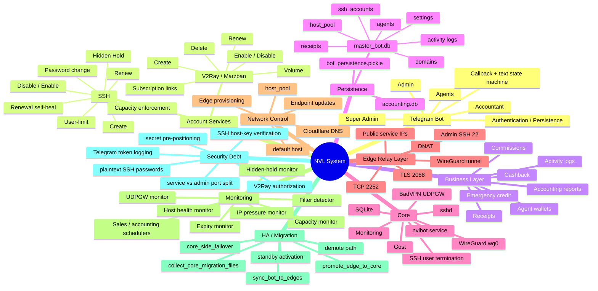
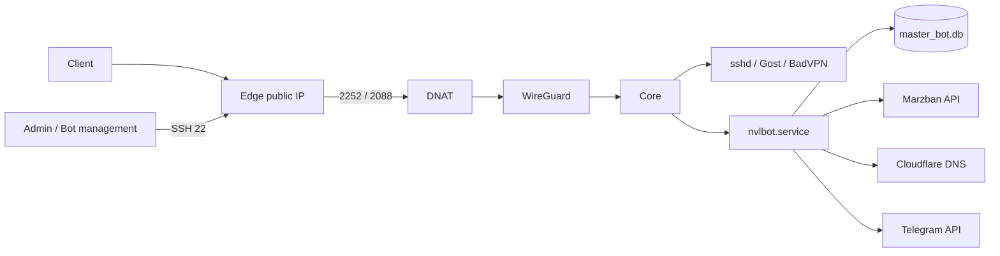

# NVL Architecture Context Map — 2026-09-30

This document is a compact working context for future development and review. It describes the architecture observed in production plus the current repository state. It is not a claim that every legacy script matches the active production topology.

## 1. System mind map



## 2. Active production topology



Observed production model:

- Edge is primarily a relay.
- SSH customer sessions terminate on Core.
- Edge service ports are forwarded through WireGuard to Core.
- Edge management is a separate SSH path on port 22.
- This distinction is not yet represented cleanly in the data model.

## 3. Telegram / application control plane

Main module: `bot_final_v49-2.py`

The main Python file currently owns most application responsibilities:

- Telegram UI and navigation
- authentication and role state
- agent and admin workflows
- SSH account lifecycle
- V2Ray account lifecycle
- wallet / commission / cashback logic
- receipts and accounting
- host / Edge management
- monitoring loops
- failover triggers
- Cloudflare operations
- system commands

This is a functional monolith. It works, but large callback/text handlers and string-based states increase regression risk.

## 4. SSH account lifecycle

### Create

```
Telegram action
    -> reserve username atomically in SQLite
    -> choose host
    -> useradd
    -> chpasswd
    -> finalize DB row
    -> set host
    -> write users_limit
    -> wallet / commission
    -> invoice
```

There are explicit rollback paths for user creation and DB reservation.

### Hidden Hold

New accounts may stay in hidden-hold state until:

- first real connection, or
- hold deadline expires.

On activation, the final expiry date is calculated and synchronized to Linux.

### Capacity enforcement

Core live SSH sessions are counted centrally.

If a user exceeds the allowed connection count continuously beyond the configured threshold:

- Linux account is locked
- DB status is updated
- live sessions are terminated
- DB failure triggers Linux rollback

This path was repaired and E2E validated during the audit.

### Renewal self-heal

Production incident found on 2026-09-30:

- 768 SSH accounts existed in DB
- 409 corresponding Linux users existed
- 359 inactive DB accounts had no Linux user
- 0 active DB accounts were missing from Linux

Cause: migration/rebuild restored active users but left expired/inactive historical accounts only in DB.

Current renewal behavior now self-heals:

```
renew
  -> check Linux user
  -> if present: normal renewal
  -> if missing:
       rebuild user from DB
       restore password
       restore users_limit
       continue renewal
  -> update expiry
  -> unlock
  -> activate DB record
```

E2E test passed with `nevel0460`.

## 5. V2Ray / Marzban

Module: `v2ray_engine.py`

Bot communicates with Marzban over REST API for:

- authentication token
- create user
- get user
- modify user
- delete user
- online-user data
- subscription URL

Known issue: authorization checks are not consistently enforced across all V2Ray detail/action callbacks. This remains a P0 application-security item.

## 6. Business / finance

Agent-side functions include:

- wallet balance
- emergency credit
- receipt approval
- network commissions
- cashback
- withdrawal pool
- financial reports
- activity logging

Important correctness debt:

Account provisioning and financial settlement are not one atomic transaction across Linux / SQLite / Marzban / wallet state.

A service can succeed while a later financial step fails.

Long-term direction: explicit transaction / operation states with idempotent retries and compensating actions.

## 7. Data stores

### `master_bot.db`

Primary operational SQLite DB. It contains:

- SSH/V2Ray account records
- account ownership
- account host
- passwords used for SSH reconstruction
- agents
- balances
- settings
- host pool
- receipts
- domains
- monitoring/failover settings

Current concern: SSH customer passwords are recoverable/plaintext because migration and self-heal require `chpasswd`.

### `accounting.db`

Separate accounting-oriented database.

### `bot_persistence.pickle`

Telegram persistence for user/session state such as logged-in role and agent identity.

## 8. Core responsibilities

Current Core is both application control plane and central SSH data plane.

Core owns:

- Telegram bot
- SQLite DB
- SSH users
- active customer SSH sessions
- WireGuard hub
- BadVPN UDPGW
- Gost / TLS bridge
- monitoring loops
- Cloudflare switching logic
- migration/failover orchestration

This concentration makes Core highly important and explains why migration/failover code is complex.

## 9. Edge responsibilities

Active production Edge model:

- public customer-facing IP
- service-port forwarding
- WireGuard peer
- management SSH on port 22

Normal Edge does **not** need local SSH customer users in the observed relay architecture.

Repository also contains `setup_edge_datapath.sh`, which describes a different Edge-as-data-plane architecture. That model must not be mixed silently with the active relay model.

## 10. Monitoring map

### Capacity monitor
Signal: live sessions per SSH username on Core.

Purpose: enforce simultaneous-user limits.

### Hidden Hold monitor
Signal: first connection / hold deadline.

Purpose: start real account lifetime at first use or deadline.

### Expiry monitor
Signal: DB expiry and Marzban status.

Purpose: mark expired accounts inactive.

### IP pressure monitor
Signal: Core CPU / RAM / load.

Purpose: warn and optionally rebalance host assignments.

### Host health monitor
Signal: TCP reachability using current host port field.

Problem: service port and management port are conflated; a forwarded service port may prove Core reachability rather than Edge management health.

### Filter detector
Signal: global ratio of online SSH accounts.

Problem: Core-only global counts cannot identify which Edge is filtered.

### UDPGW monitor
Signal: BadVPN availability.

### Scheduled reports
Daily sales and weekly accounting jobs.

## 11. Failover / migration

Relevant scripts:

- `collect_core_migration_files.sh`
- `sync_bot_to_edges.sh`
- `core_side_failover.sh`
- `promote_edge_to_core.sh`
- `promote_standby_for_filtered_edge.py`
- `update_edge_endpoint.sh`
- `update_all_edges_endpoint.sh`
- `preflight_check.sh`
- legacy `demote_core_to_edge.sh.bak`

Current failover blockers:

1. no validated active `demote_core_to_edge.sh`
2. script naming / argument contracts disagree
3. management SSH vs service port ambiguity
4. target identity is not strongly verified
5. migration material is over-distributed to Edge nodes
6. standby activation can rewrite more account-host rows than it rebuilds

Automated failover should not yet be treated as fully production-safe.

## 12. Source-of-truth status

GitHub currently contains the sanitized codebase and audit documentation.

Production still differs from GitHub in runtime configuration and some manually applied hotfix details.

Current GitHub head at the time of this map:

`7ecfe231a82df33380fa1eef995a6a113587f9cc`

The production runtime should not yet be blindly replaced from GitHub until environment/secrets migration and controlled deployment validation are completed.

## 13. Current risk map

### P0

- V2Ray authorization boundary
- split `service_port` vs `admin_ssh_port`
- control-plane secrets distributed to Edges
- missing/invalid demote path
- production/GitHub runtime convergence

### P1

- per-Edge filtering detection
- host-health semantics
- standby host-update scope
- financial atomicity
- encrypted SSH credential storage

### P2

- SSH host-key verification
- remove / isolate alternate Edge architecture
- split monolith into services/modules
- versioned DB migrations
- unified version/build identifier
- Marzban token cache keyed by backend
- Telegram HTTP log redaction

## 14. Recommended development boundaries

When adding new features, treat the system as these logical modules even before physical code extraction:

```
telegram/
    auth
    menus
    handlers

accounts/
    ssh
    v2ray
    lifecycle
    authorization

billing/
    wallet
    commissions
    receipts
    ledger

infra/
    core
    edge
    wireguard
    cloudflare
    provisioning

monitoring/
    capacity
    expiry
    pressure
    host-health
    filtering

failover/
    promote
    demote
    migration
    standby

storage/
    repositories
    migrations
    persistence
```

This is the preferred mental model for future work even while the code remains a monolith.
